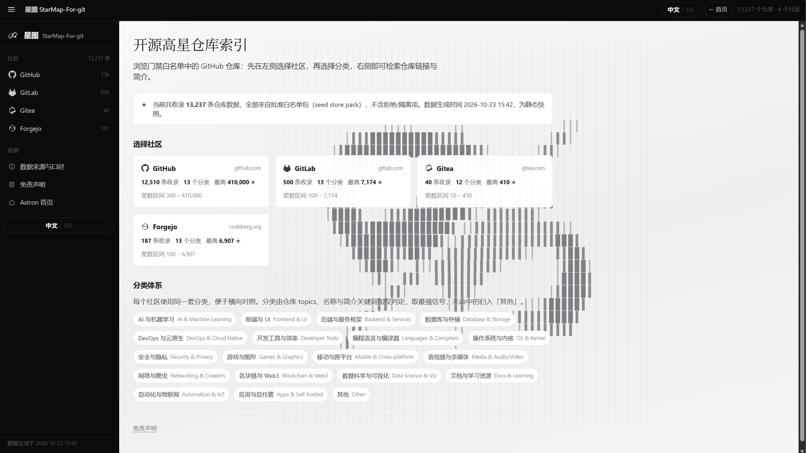
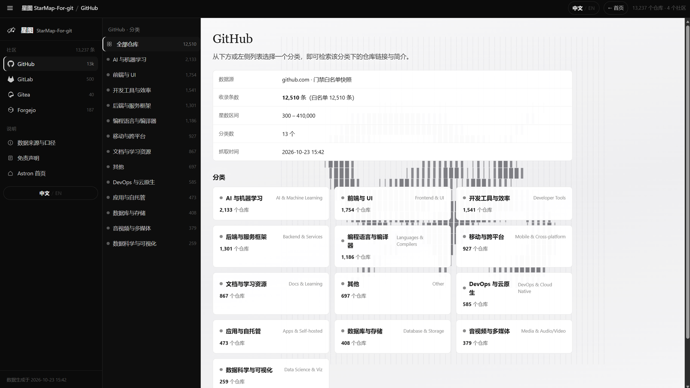
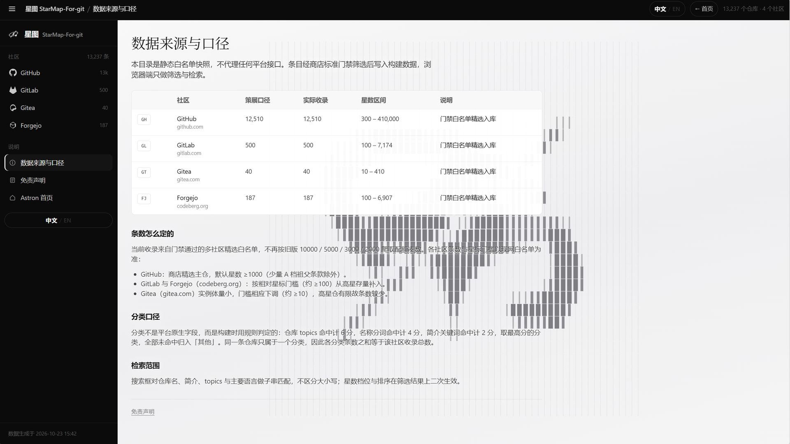

# StarMap-For-Git（星图）

**StarMap-For-Git** 是一款面向 GitHub / 开源探索的 Windows 桌面应用：用 **.NET 8 + WebView2** 宿主承载本地 SPA（`www/index.html`），提供星图式浏览与检索体验。

作者：**Felix Joe**（GitHub: [JoeJiang-927117](https://github.com/JoeJiang-927117)）  
许可证：[MIT](./LICENSE)

---

## 截图

| Landing | Hub |
|:---:|:---:|
|  |  |

| GitHub | AI Search | About |
|:---:|:---:|:---:|
|  |  |  |

Logo 资源见 [`docs/logos/`](docs/logos/)。

---

## 功能概览

- WebView2 桌面壳：`host/StarMapHost`（WinForms）
- 本地虚拟主机映射：`https://app.starmap.local/index.html`
- 内嵌 SPA：`host/StarMapHost/www/index.html`
- 宿主桥：页面可通过 WebMessage 请求打开 Apps 文件夹等（见 `MainForm.cs`）
- 商店素材：本仓库提供 1920×1080 截图与关键 Logo（**不含** MSIX / 证书 / 宣传视频）

---

## 构建与运行

### 前置

- Windows 10/11 x64  
- [.NET 8 SDK](https://dotnet.microsoft.com/download)  
- [WebView2 Runtime](https://developer.microsoft.com/microsoft-edge/webview2/)

### 一键脚本

```powershell
powershell -NoProfile -ExecutionPolicy Bypass -File .\scripts\build-host.ps1
```

发布产物默认在 `dist\host\StarMapHost.exe`。运行前请确保同目录下带有 `www\index.html` 与 `Assets\`（`csproj` 已配置 `CopyToOutputDirectory`）。

### 手动

```powershell
cd host\StarMapHost
dotnet restore
dotnet run -c Release
# 或
dotnet publish -c Release -r win-x64 --self-contained false -o ..\..\dist\host
```

### MSIX（可选）

`scripts/build-msix.ps1` 是历史打包辅助脚本，依赖本机 SDK 与自备 `starmap-host-src.zip` / 证书，**默认不随开源包提供二进制**。侧载说明见 [`docs/INSTALL-sideload.txt`](docs/INSTALL-sideload.txt)。

---

## 目录结构

```
host/StarMapHost/          # C# WebView2 宿主
  Program.cs
  MainForm.cs
  StarMapHost.csproj
  app.manifest
  Assets/                  # 应用图标 / Store tile
  www/index.html           # 桌面 SPA
scripts/
  build-host.ps1           # 推荐：本地 publish
  build-msix.ps1           # 可选：MSIX 打包辅助
docs/shots/                # 1920x1080 商店截图
docs/logos/                # 关键 Logo（非全尺寸 tile 全集）
docs/INSTALL-sideload.txt
LICENSE
```

---

## 商店 / 分发说明

本开源树为**源码与文档素材**。若你在 Microsoft Store 或其他渠道看到同名应用，以商店页面与签名包为准；此处不附带 `.msix` / `.cer` / 宣传 mp4。

---

## License

[MIT](./LICENSE) © 2026 Felix Joe / JoeJiang-927117

---

## English

**StarMap-For-Git** is a Windows desktop WebView2 app for exploring GitHub / open-source projects. The UI is a local SPA loaded by `StarMapHost` (.NET 8 WinForms).

### Build & run

```powershell
powershell -NoProfile -ExecutionPolicy Bypass -File .\scripts\build-host.ps1
```

Requirements: .NET 8 SDK, WebView2 Runtime, Windows x64.

Screenshots (1920×1080) live under `docs/shots/`. Key logos under `docs/logos/`. MIT licensed. Author: **Felix Joe** ([JoeJiang-927117](https://github.com/JoeJiang-927117)).
